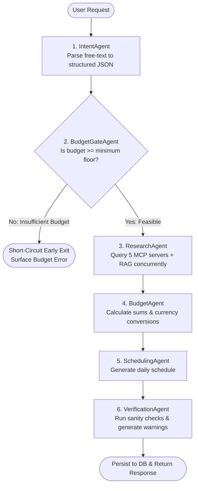

# Wanderplan — Multi-Agent Architecture & Workflow

This document explains the **LangGraph multi-agent pipeline** used in Wanderplan. It breaks down the workflow structure, how agents communicate through shared state, why certain nodes use LLMs while others are deterministic, and how failure recovery is handled.

---

## 1. Graph Structure & Conditional Routing

Wanderplan models trip planning as a directed execution graph using **LangGraph**:



---

## 2. The 6 Agents Explained

### Agent 1: `IntentAgent` (Natural Language Understanding)
- **Implementation**: Uses Groq LLM (`llama-3.3-70b-versatile`) with structured JSON schema output.
- **Goal**: Extracts core constraints from unformatted user input:
  - `origin` & `destination`
  - `start_date` & `end_date` (or calculates them based on today's real date)
  - `budget` & `currency`
  - `travelers_count`
  - `preferences` (e.g., "beaches", "food", "hiking")
- **Fallback Recovery**: If the LLM call times out or encounters a rate limit (429), a deterministic regex-based parser extracts numbers, cities, and durations without failing the request.

---

### Agent 2: `BudgetGateAgent` (Fail-Fast Guardrail)
- **Implementation**: **Deterministic rule-based (No LLM)**.
- **Goal**: Evaluates whether the requested budget can realistically support the trip length.
  - Formula: $\text{Floor} = \text{Days} \times \text{Travelers} \times ₹1,500$ (or currency equivalent).
- **Why No LLM?**:
  - Arithmetic should be deterministic and fast.
  - Calling an LLM to check basic arithmetic wastes tokens and latency.
- **Routing**: If the budget is below the floor, the graph conditionally branches directly to the end node, avoiding expensive external tool calls for impossible requests.

---

### Agent 3: `ResearchAgent` (Concurrent Tool Orchestration)
- **Implementation**: Asynchronous orchestrator (`asyncio.gather`).
- **Goal**: Gathers real-world context by querying all 5 MCP servers and the RAG engine in parallel:
  1. `get_weather_forecast` (Open-Meteo)
  2. `search_flights` (Duffel API)
  3. `search_hotels` (Google Places API)
  4. `search_attractions` (OpenStreetMap Overpass API)
  5. `search_transport` (OpenStreetMap Overpass API)
  6. `retrieve_destination_guide` (Qdrant Dense Vector + BM25 Sparse Search)
- **Fault-Tolerant Execution**: Each call is wrapped with an individual `try/except` block. If `search_hotels` fails, the other 4 tools and RAG results still complete normally.
- **Cache-Aside Layer**: Checks Redis using a SHA-256 hash of `(tool_name, arguments)` before dispatching outbound HTTP calls.

---

### Agent 4: `BudgetAgent` (Financial Reconciliation)
- **Implementation**: **Deterministic rule-based (No LLM)**.
- **Goal**:
  - Sums real hotel costs and flight prices.
  - Converts mixed currencies to the user's primary currency using exchange rate tables.
  - Computes remaining daily allowance for food and miscellaneous expenses.
  - Flags any `missing_estimates` (e.g., when hotel pricing data is unavailable).

---

### Agent 5: `SchedulingAgent` (Itinerary Synthesis)
- **Implementation**: Groq LLM (`llama-3.3-70b-versatile`) with structured JSON output.
- **Goal**: Assembles a day-by-day plan:
  - Groups attractions geographically to minimize travel time.
  - Incorporates weather forecasts (e.g., indoor museums on rainy days, beaches on sunny days).
  - Integrates destination guide tips retrieved from the RAG knowledge base.
- **Fallback Recovery**: If the LLM is unavailable, a round-robin scheduler distributes attractions evenly across the trip days.

---

### Agent 6: `VerificationAgent` (Quality Assurance)
- **Implementation**: **Deterministic rule-based (No LLM)**.
- **Goal**: Runs post-generation validation checks:
  - Ensures the number of scheduled days matches `end_date - start_date`.
  - Checks that no days are empty.
  - Verifies that estimated costs remain within reasonable variance of the budget.
  - Appends diagnostic notices to the `warnings` array returned to the user.

---

## 3. LangGraph Shared State Schema

All agents read from and write to a centralized state object (`TripPlanState`):

```python
class TripPlanState(TypedDict):
    # User Inputs
    raw_prompt: str
    user_id: str
    thread_id: str

    # IntentAgent Output
    destination: str
    origin: str | None
    start_date: str
    end_date: str
    budget: float
    currency: str
    travelers_count: int
    preferences: list[str]

    # ResearchAgent Outputs
    weather_data: dict | None
    flights_data: list[dict]
    hotels_data: list[dict]
    attractions_data: list[dict]
    transport_data: list[dict]
    rag_passages: list[str]

    # Budget & Itinerary Outputs
    budget_breakdown: dict
    itinerary_days: list[dict]
    warnings: list[str]
    is_feasible: bool
```

---

## 4. Design Philosophy

| Question | Engineering Decision |
| :--- | :--- |
| **Why not one giant prompt?** | A single prompt hallucinates weather and prices, cannot call isolated microservices reliably, and makes debugging impossible. |
| **Why isn't every agent an LLM?** | Arithmetic, budget gating, and verification must be 100% deterministic, instant, and cost-free. |
| **How is state preserved across restarts?** | LangGraph uses PostgreSQL checkpointing (`langgraph-checkpoint-postgres`), ensuring trip states persist across container restarts. |
