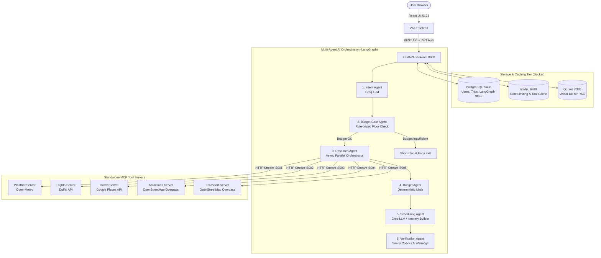

# Wanderplan — System Overview & Architecture Guide

A complete, beginner-friendly yet deeply technical guide to understanding how **Wanderplan (Production Travel Planner)** is built, how its microservices communicate, and how the multi-agent AI pipeline generates personalized itineraries.

---

## 1. Executive Summary

Wanderplan is an **AI-powered travel planning platform**. Instead of relying on a single prompt or hallucinations, Wanderplan:
1. Takes a single natural-language user prompt (e.g., *"5-day trip to Goa from Mumbai for 2 travelers, budget ₹60,000, love food and beaches"*).
2. Parses user constraints using an **LLM Intent Agent**.
3. Validates budget feasibility with a **Budget Gate**.
4. Queries **5 isolated Model Context Protocol (MCP) microservices** in parallel to fetch real-world flights, hotels, weather forecasts, attractions, and local transport.
5. Ingests local travel tips via a **Hybrid RAG Pipeline** (Dense Vector + BM25 Sparse Search).
6. Builds a day-by-day itinerary with an **LLM Scheduling Agent**.
7. Verifies the sanity of the output and stores the trip in a persistent database.

---

## 2. High-Level Architecture Diagram



---

## 3. Project Directory Map

```
production-travel-planner/
├── frontend/                       # Vite + React 19 + Tailwind CSS Web UI
│   ├── src/
│   │   ├── components/             # Reusable UI widgets (cards, forms, alerts)
│   │   ├── pages/                  # Planner, Trip View, Auth (Login/Signup)
│   │   └── services/               # API client & fetch wrappers
│   └── .env                        # Points to Backend (VITE_API_BASE_URL)
│
├── services/
│   ├── api/                        # Main FastAPI backend
│   │   ├── app/
│   │   │   ├── api/routes/         # /auth, /trips, /tools HTTP endpoints
│   │   │   ├── core/               # App config, database session, rate limiting
│   │   │   ├── mcp_clients/        # Clients connecting to MCP tool servers
│   │   │   ├── orchestration/      # LangGraph multi-agent state graph
│   │   │   └── rag/                # Hybrid search (dense + BM25) destination guide
│   │   ├── alembic/                # Database schema migrations
│   │   ├── run.py                  # Windows-compatible server runner
│   │   └── requirements.txt
│   │
│   ├── mcp-weather-server/         # MCP Server on port 8001 (Open-Meteo)
│   ├── mcp-flights-server/         # MCP Server on port 8002 (Duffel API)
│   ├── mcp-hotels-server/          # MCP Server on port 8003 (Google Places API)
│   ├── mcp-attractions-server/     # MCP Server on port 8004 (OSM Overpass API)
│   └── mcp-transport-server/       # MCP Server on port 8005 (OSM Overpass API)
│
├── infra/                          # Infrastructure & local container configs
│   ├── docker-compose.yml          # Postgres (5432), Redis (6380), Qdrant (6335)
│   └── .env                        # Database connection credentials
│
├── start-everything.bat            # One-click Windows startup script
├── stop-everything.bat             # One-click Windows shutdown script
├── PROJECT_OVERVIEW.md             # This comprehensive architecture document
├── ENV_GUIDE.md                    # Complete environment variables reference
├── AGENTS_AND_WORKFLOW.md          # Multi-agent LangGraph breakdown
└── HOW_TO_RUN.md                   # Step-by-step execution & troubleshooting
```

---

## 4. Key Architectural Pillars

### 1. Why 5 Independent MCP Servers Instead of In-Process Functions?
- **Fault Isolation**: External travel APIs (like OpenStreetMap or flight aggregators) can be slow or encounter temporary rate limits. If a tool server hangs or errors, it never crashes the backend API.
- **Process Independence**: Each tool server has its own virtual environment, dependencies, and port (`8001`-`8005`).
- **Standard Protocol**: Built on the open **Model Context Protocol (MCP)** standard using Streamable HTTP.

### 2. Multi-User Safety & Horizontal Scalability
- **Stateless Authentication**: Uses standard JWT tokens (`Authorization: Bearer <token>`). Any replica can handle any user request.
- **Thread Isolation**: Every trip plan generates a unique `thread_id` (UUID) in LangGraph's PostgreSQL checkpointer. Concurrent users will never overwrite or see each other's planning state.
- **Redis Cache-Aside**: Tool results are cached in Redis keyed by `tool_name + hash(args)` rather than user ID. If two users search for flights from Mumbai to Goa for the same dates, the second user receives the cached result instantly.
- **Global Rate Limiting**: Redis-backed distributed rate limiting prevents API abuse regardless of how many backend instances are running.

### 3. Graceful Degradation
- If `GROQ_API_KEY` is not provided, the system falls back to rule-based heuristic parsing and round-robin scheduling instead of failing.
- If an individual tool (e.g., Duffel Flights or Google Places) is missing an API key, only that component is omitted, while the rest of the itinerary is built normally.

---

## 5. End-to-End Request Flow

1. **User Action**: The user signs in on the frontend (`http://localhost:5173`) and submits a trip prompt on the trip form.
2. **FastAPI Route**: The frontend calls `POST /api/trips/plan`. FastAPI validates the user's JWT token.
3. **LangGraph Graph Execution**:
   - `IntentAgent` converts free text into structured JSON (`origin`, `destination`, `dates`, `budget`, `preferences`).
   - `BudgetGateAgent` verifies that the budget meets minimum per-day thresholds.
   - `ResearchAgent` fires concurrent calls to the 5 MCP servers and queries the Qdrant RAG store.
   - `BudgetAgent` computes arithmetic sums, currency conversions, and budget variance.
   - `SchedulingAgent` arranges attractions, meals, and transit into a logical daily schedule.
   - `VerificationAgent` checks that the day count matches and flags missing details.
4. **Persistence & Return**: The generated trip is saved in PostgreSQL under the user's profile and returned to the frontend.

---

## 6. Documentation Index

- [ENV_GUIDE.md](file:///c:/Users/hardi/OneDrive/Desktop/Ai%20Agentic%20Travel%20Planner/production-travel-planner/ENV_GUIDE.md) — Detailed explanation of all `.env` files and API keys.
- [AGENTS_AND_WORKFLOW.md](file:///c:/Users/hardi/OneDrive/Desktop/Ai%20Agentic%20Travel%20Planner/production-travel-planner/AGENTS_AND_WORKFLOW.md) — Deep dive into the 6 agents, state schema, and prompt design.
- [HOW_TO_RUN.md](file:///c:/Users/hardi/OneDrive/Desktop/Ai%20Agentic%20Travel%20Planner/production-travel-planner/HOW_TO_RUN.md) — Startup instructions, prerequisites, and runtime management.
